<picture><source media="(prefers-color-scheme: dark)" srcset="assets/hero-dark.svg"></picture>

<a href="https://t.me/cuteemus"><picture><source media="(prefers-color-scheme: dark)" srcset="assets/button-1-dark.svg"></picture></a>&nbsp;&nbsp;<a href="https://github.com/musdev13?tab=repositories"><picture><source media="(prefers-color-scheme: dark)" srcset="assets/button-2-dark.svg"></picture></a>

<a href="https://t.me/tomorrowqq"><picture><source media="(prefers-color-scheme: dark)" srcset="assets/social-1-dark.svg"></picture></a>&nbsp;<a href="https://gravatar.com/cuteemus"><picture><source media="(prefers-color-scheme: dark)" srcset="assets/social-2-dark.svg"></picture></a>

<picture><source media="(prefers-color-scheme: dark)" srcset="assets/about-dark.svg"></picture>

<picture><source media="(prefers-color-scheme: dark)" srcset="assets/stack-dark.svg"></picture>

<a href="https://github.com/musdev13/rml"><picture><source media="(prefers-color-scheme: dark)" srcset="assets/project-rml-dark.svg"></picture></a>&nbsp;<a href="https://github.com/musdev13/rmlib"><picture><source media="(prefers-color-scheme: dark)" srcset="assets/project-rmlib-dark.svg"></picture></a>

<a href="https://github.com/musdev13/musutils"><picture><source media="(prefers-color-scheme: dark)" srcset="assets/project-musutils-dark.svg"></picture></a>&nbsp;<a href="https://github.com/musdev13/LegacyTUI"><picture><source media="(prefers-color-scheme: dark)" srcset="assets/project-legacytui-dark.svg"></picture></a>

<picture><source media="(prefers-color-scheme: dark)" srcset="assets/wave-dark.svg"></picture>

<picture><source media="(prefers-color-scheme: dark)" srcset="assets/streak-dark.svg"></picture>

<picture><source media="(prefers-color-scheme: dark)" srcset="assets/stats-dark.svg"></picture>

<a href="https://metawka.github.io/expressive-profile/?from=musdev13"><picture><source media="(prefers-color-scheme: dark)" srcset="assets/credit-dark.svg"></picture></a>

